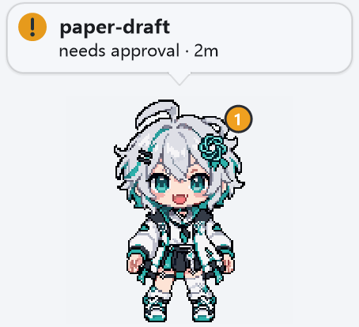
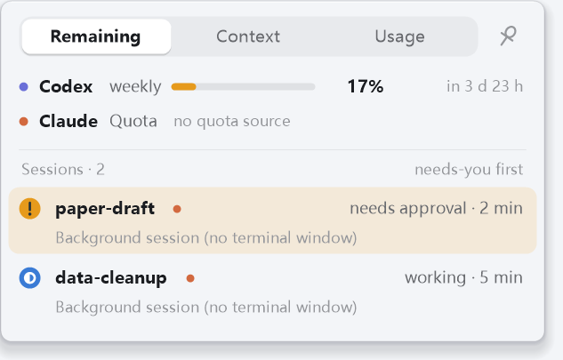

# claude-companion-pet

A small desktop character that sits on your screen while Claude Code (and Codex) work, and **calls you back when a session needs you**: an approval, a question, an error. Hover over it for a panel with your remaining quota, how full each conversation's context is, and what you have used.

Windows only. One `pet.exe` (about 280 KB) and a `skins` folder. No Node.js, no installer, no admin rights.


| It calls you back | Hover for the panel | Sol, one of the animations |
|---|---|---|
|  |  |  |

(The two sessions in the pictures are stand-ins made up for the screenshot.)

## What it does

- **Calls you back.** While nothing needs you it is quiet. When a session waits for an approval or an answer it waves, and a speech bubble says which project and why. Click the bubble to jump to that terminal window. It never takes the keyboard focus, makes no sound unless you switch it on, and hides while a full-screen app is in front.
- **Remaining quota.** Claude's 5-hour and weekly windows and Codex's windows, as bars. The small floating strip shows the tightest window of each assistant (`Claude 66%  Codex 17%`).
- **Context per conversation.** A list of your running sessions (project, the last thing you said in it, state, how full its context window is) and, for the one you pick, the split into fixed overhead / your messages / assistant text / tool results (the split is an estimate from the conversation file; the total is the measured number).
- **Usage.** Today / 7 days / 30 days as an API-equivalent price (not a bill), by assistant and model or by token kind (input / cache read / cache write / output), with a bar chart.
- **A background record** (30 days, numbers only): `stats\hourly-30d.csv` (one line per hour, assistant and model) and `stats\quota-30d.csv` (the quota situation whenever it changed).
- **English or Chinese**, light or dark, frosted-glass panel, a tray icon whose ring shows your tightest quota.

## Use it

1. Download `claude-companion-pet-*.zip` from the Releases page, unzip it somewhere permanent and run `pet.exe`. (Windows may warn about an unsigned program: *More info → Run anyway*.)
2. Right-click the character → **Connect Claude Code…** and follow the three short steps. This adds hooks and a status line command to `~/.claude/settings.json` (a backup is kept; **Disconnect** removes them again). Sessions that are already open pick it up after their next event or a restart.
3. Codex sessions and the Codex quota are read without any setup.
4. Updating: right-click → **More → Check for updates…**. It asks GitHub for the latest release, shows what is new, and on a yes downloads the zip, checks its SHA-256 against the one GitHub lists, closes the pet, copies the new `pet.exe` / `skins` / `prices.json` over the program folder (your settings and statistics are kept) and starts it again. It only runs when you click it.

The default skin is a small lantern robot; **Sol** (a pixel girl with short animations) is in the skin menu.

## Privacy

Everything is read from files on your own machine: the hook events, Claude Code's conversation files (only token counts and the last message's first line for naming), Codex's session files and quota report. Nothing leaves the machine unless you tick **More → Read Claude limits from the account**: then the Claude Code login token is used for one read-only request every 5 minutes to the Anthropic usage endpoint (the token is not stored or logged). That option is off by default. The only other network access is the update check you start yourself (api.github.com, no personal data sent).

## Build

```
build.cmd                       # needs only the C# compiler that ships with Windows (.NET Framework 4)
powershell -File tools\package.ps1   # pet.exe + skins + prices.json -> dist\*.zip
```

`prices.json` is the price table behind the usage figures (list prices read from the vendors' pages on 2026-11-03; edit it when prices change).

## Limits

- Windows 10 / 11 only. The window comes to the front, but Windows Terminal cannot be told which *tab* to select.
- Context window size: taken from Claude Code's status line when it reports one, otherwise assumed from the model name (marked in the panel).
- The quota and usage figures come from other tools' local files and may lag or disagree with the vendors' dashboards; the panel says when a number is stale.
- No test suite is published yet.

## Skins

See [skins/README.md](skins/README.md). The robot is drawn in code; the Sol pictures were generated with the owner's own PixelLab account and edited by hand.

## License

MIT, for everything in this repository including the artwork in `skins/`. The Sol pictures were generated by the project owner with PixelLab (their own paid account) and edited by hand; use them for anything you like.
